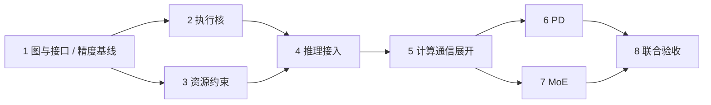

# DAG 改造八阶段分工与验收计划

## 1. 交付目标

**交付接入现有推理流程的完整DAG仿真系统，并以原模型参考数据和原SimAI结果为对照，验证改造后的预测误差降低。**

- 总周期：2026年10月31日—11月20日，21个自然日。
- 最终DDL：**11月20日22:00，北京时间**。下文日期均为2026年，阶段DDL均为当日22:00。
- 按八个阶段交付、验收、交接；阶段6、7并行。
- 完整流程：原有输入/配置 → 请求调度 → DAG构图与执行 → 事件与资源推进 → 请求完成 → 指标与时间线输出。
- 支持范围按已有参考数据和原SimAI能够对照的模型、backend、硬件及并行配置确定，阶段1冻结配置清单。已有功能保留，未验证组合单独标注。
- 功能正确与精度提升分别验收；精度评估从阶段1开始，不等到最后集中补数据。

## 2. 分工与时间安排

- 下游阶段负责人接收上游接口与验收结果；涉及公共模块的修改，与该模块上一阶段负责人确认后合入。

历时按自然日计算。阶段2/3、4/5可交叠开发；进入下游运行验收前，必须满足前置条件。

| 阶段 | 日期 | 负责人（自行认领） | 必须交付 | DDL |
|---|---|---|---|---|
| 1. 定义任务图与执行边界 | 10/31—11/1 | 待认领 | 图schema、接口、配置清单、参考数据清单、原SimAI误差基线与主指标 | **11/1** |
| 2. 最小DAG执行核 | 11/2—11/4 | 待认领 | 前驱计数、Ready/事件队列、完成解锁、可运行小图 | **11/4** |
| 3. 资源约束 | 11/4—11/6 | 待认领 | 计算/通信/KV资源接口、原子申请/释放、等待和并行测试 | **11/6** |
| 4. 接入现有推理执行链 | 11/7—11/10 | 待认领 | 原入口下的端到端DAG执行、旧/新路径开关、行为回归 | **11/10** |
| 5. 拆分计算与通信任务 | 11/10—11/13 | 待认领 | 分项计算/通信图、cost与资源适配、首次参考数据误差对照、冻结扩展接口 | **11/13** |
| 6. PD分离 | 11/14—11/17 | 待认领 | KV传输与就绪门控、容量背压、PD时间线与误差结果 | **11/17** |
| 7. 动态MoE | 11/14—11/17 | 待认领 | 动态路由、Expert/Group、dispatch/combine、拖尾及误差结果 | **11/17** |
| 8. 回归、校准与规模优化 | 测试全程；集中11/18—11/20 | 待认领 | 端到端回归、独立验证集误差报告、运行开销、复现与最终系统 | **11/20** |

PD/MoE可在阶段5期间准备输入、测试和接口消费代码；接入执行依赖阶段5验收。两阶段复用同一执行核与资源管理器，公共接口变更统一合入。



## 3. 各阶段任务、交付与验收

### 阶段1：定义任务图与执行边界

**任务**

- 定义Task、依赖、图片段和终端回调，以Batch iteration/Stage为边界。
- 定义状态与时间推进、资源与cost接口，核对原耗时是否含通信。
- 整理已有原模型数据与原SimAI结果，按模型、硬件、输入、并行配置、指标和单位逐项配对，计算旧系统误差。
- 冻结首批支持配置、主要精度指标和验证样本；将调参/校准数据与最终独立验证数据分开。

**交付**：schema、最小接口、三份手算图、配置与数据配对表、旧系统误差表、验收指标。

**验收**：数据能够逐条对照；原模型数据的测量/估计属性清楚；参考值覆盖的指标明确。只有kernel trace或估计值的数据，不冒作端到端实测真值。下游阶段可依据冻结接口继续开发。

### 阶段2：实现最小DAG执行核

**任务**：实现图校验、前驱计数、Ready队列、事件队列、状态和完成解锁；使用阶段1的图输入，提供CLI及逐任务时序输出。先用常量耗时验证执行逻辑。

**交付**：可运行执行核、统一命令、串行/fork-join测试和timeline.csv。

**验收**：任务T1=3、T2=5并行、T3=2等待二者时总时长为7；前驱未完成不能启动后继；每节点完成一次。拒绝有环/缺引用/非法时延；同时间处理确定，零时长链可收敛，不允许时间回退。

### 阶段3：加入资源约束

**任务**：实现计算/通信资源、KV容量接口、多资源原子申请/释放、等待者唤醒；将Dispatcher接入资源管理器，验证占用与等待。

计算资源首版采用每设备一个执行许可，允许不同设备并行；通信是否占GPU由配置表达。后续根据参考数据校准并发假设，不把“无依赖”直接视为真实硬件可完全并行。

**交付**：ResourceManager、compute/comm占用配置、KV reserve/commit/release接口、资源时间线。

**验收**：同图T1=10μs、T2=4μs独立、T3=8μs等两者，得到串行22μs、独立资源18μs、T2同时占compute时22μs；容量不超限、失败申请无残留、完成恰好释放一次。该测试不作为精度提升结论。

### 阶段4：接入现有推理执行链

**任务**：将BatchStage映射为coarse任务，图terminal触发原StageEnd，保留组批与token推进；统一原事件循环与DAG时钟，适配原预测器，比较原模型、旧SimAI和coarse DAG结果。

**交付**：原入口下可完成请求的DAG路径、模式开关、请求与阶段级对照表。

**验收**：相同输入与cost下，coarse路径与旧路径的token计数、请求终结和阶段耗时一致，完成回调一次。DAG实际控制时间推进；本阶段优先保证接入正确，不要求仅靠更换执行器就降低误差。旧模型已知问题另设修正测试，不能混入兼容性比较。

### 阶段5：拆分计算与通信任务

**任务**

- 展开层级compute与sync，实现TP/PP/EP通信描述、分项cost和设备/通信组映射，保持公共执行核通用。
- 按阶段1配置清单接入实际使用的算子。所有费用只计一次，原Stage聚合cost不得与子任务重复收费。
- 用参考时间线/时延定位旧误差来自依赖、重叠、争用还是cost偏差，输出首次新旧误差对照；调参仅使用校准数据。
- 冻结图、资源、cost及终端回调接口，供PD/MoE共同消费。

**交付**：实际推理链中的计算通信子图、核验通过的cost、资源/重叠时间线、误差分解与对照结果。

**验收**：必要依赖完整，资源独立才能并行；通信/计算无漏算与重复计算；对已匹配样本能够解释新旧预测差异。首次误差未降低时定位并修正，不能直接把结构更细当作精度改善。

### 阶段6：PD分离（与阶段7并行）

**任务**：实现Prefill→KV transfer→receive commit→KVReady→Decode，源KV pin、目标容量reserve与接收后释放；覆盖双请求提前消费、容量背压及PD参考指标对照。

先覆盖配置清单对应的KV布局、dtype、TP/PP；不同P/D分片配置需要显式映射，存储bytes和wire bytes分别计算。

**交付**：接入请求流程的PD功能、KV容量记录、单/双请求测试、PD时间线及有参考样本的误差结果。

**验收**：`first_decode_start >= kv_ready`；其他调度事件不能提前消费未就绪请求；目标满则等待、释放后前进；源占用跨传输、结束无泄漏。对没有PD参考数据的场景只验功能和逻辑，不推导其真实精度。

### 阶段7：动态MoE（与阶段6并行）

**任务**：实现每轮RoutingResult、dispatch、Expert/ExpertGroup、combine和join，接入动态图片段并复用公共执行核。不同Expert按各自负载独立估时，共享GPU/NIC资源。

至少覆盖多轮不同路由、均衡与热点两类输入；同轮up/down复用路由。原模型有对应Expert画像时使用匹配cost，合成函数仅作逻辑测试；目的端计数不能代替完整source→destination矩阵。

**交付**：动态MoE执行、Expert计数与通信矩阵、共享资源等待和join尾部时间线、有参考样本的误差结果。

**验收**：无drop时总assignments等于tokens×top-k；同卡排队、异卡并行、join等必需分支；受控热点用例产生可解释拖尾。真实负载样本与合成压力样本分别报告。

### 阶段8：回归、校准与规模优化

**任务**

- 组织基础图、推理链、PD、MoE及联合场景回归；涉及上游模块的缺陷交由对应阶段负责人修复。
- 参数冻结后运行独立验证集，逐样本比较原模型参考值、旧SimAI、新DAG SimAI。
- 记录至少三档规模的任务/事件数、执行墙钟、队列峰值和内存；必要时采用懒生成、完成图回收及缓存优化。
- 另一人按说明从新环境复现主要结果。

**交付**：完整系统、支持配置、独立验证集精度报告、功能测试结果、任务时间线、开销基线、复现命令和已知限制。

**验收**：满足第4节功能与精度两类门槛。未降低误差的指标如实列出；未通过主指标不能标“精度提升已完成”。

## 4. 精度与系统验收

### 4.1 对照方式

| 数据 | 作用 | 使用规则 |
|---|---|---|
| 原模型参考数据 | 评价预测误差 | 核对测量来源、时间单位与覆盖范围，保留原始值 |
| 原SimAI结果 | 改造前基线 | 匹配相同输入、硬件/并行配置和指标定义，固定版本与参数 |
| 新DAG SimAI结果 | 改造后结果 | 使用相同评估条件；记录DAG/资源/cost配置，不因换配置制造改善 |

优先用相同cost比较时序机制，再单独比较cost校准效果。报告区分“DAG依赖/资源改进”和“耗时参数修订”的贡献；不将最终验证集的测量结果直接填入任务cost。

### 4.2 指标与提升门槛

对每个有参考值的指标，记录：

```text
绝对误差 = |预测值 - 参考值|
相对误差 = |预测值 - 参考值| / |参考值|    （参考值非零）
误差降低量 = 旧误差 - 新误差
```

- 阶段1根据可用数据指定一个主要指标及其汇总方法，例如E2E/ITL的MAE或平均相对误差；冻结目标场景，不能事后只挑改善样本。
- 最终独立验证集上，主要指标的汇总误差必须低于旧SimAI，且改善不能仅来自显示舍入或测量波动。旧误差已为0时保持不退化，不强求负误差。
- 同时报告逐样本结果、样本数、改善/持平/退化数量、其他指标和运行成本；重复测量有波动时报告区间。
- TTFT、ITL/TPOT、E2E、通信/Expert时延只对参考数据确实覆盖的指标评估，不把kernel时间当请求E2E，也不把两个模拟器相互接近称为硬件精度提升。
- 原模型参考数据若是估计或模拟结果，结论写为“相对该参考模型误差降低”；有匹配实测数据才能进一步声称真实性能预测更准。

### 4.3 最终交付检查

- [ ] 原入口下跑通请求生成/调度、DAG执行、请求完成及指标输出。
- [ ] 图、时间、依赖、资源、确定性和完成回调测试通过。
- [ ] 计算通信分项与资源模型进入实际推理路径，费用无重复。
- [ ] PD和动态MoE使用同一执行核，分别验收并有联合回归。
- [ ] 原模型、原SimAI、新系统数据逐条对应，校准/验证集分离。
- [ ] 独立验证集主要误差降低，其他指标与退化场景完整报告。
- [ ] timeline.csv、Chrome trace、summary、性能开销与复现说明齐全。
- [ ] 功能完成、参考模型对照、真实硬件校准状态分别标注。

## 5. 阶段交接规则

每阶段提交四项：**代码版本、运行命令、验收结果、遗留问题**。

阶段6/7由各自认领人独立开发与验证，最后统一集成；公共核或资源协议变更与对应阶段负责人确认后提交。出现影响下游的阻塞及时说明，不等最终DDL才披露。

所有阶段保留绝对DDL；提前完成可提前进入后续阶段。进度延误时优先保完整推理闭环和参考数据对应的功能，删减额外配置/展示扩展，不将精度验收改成仅展示时间线。
