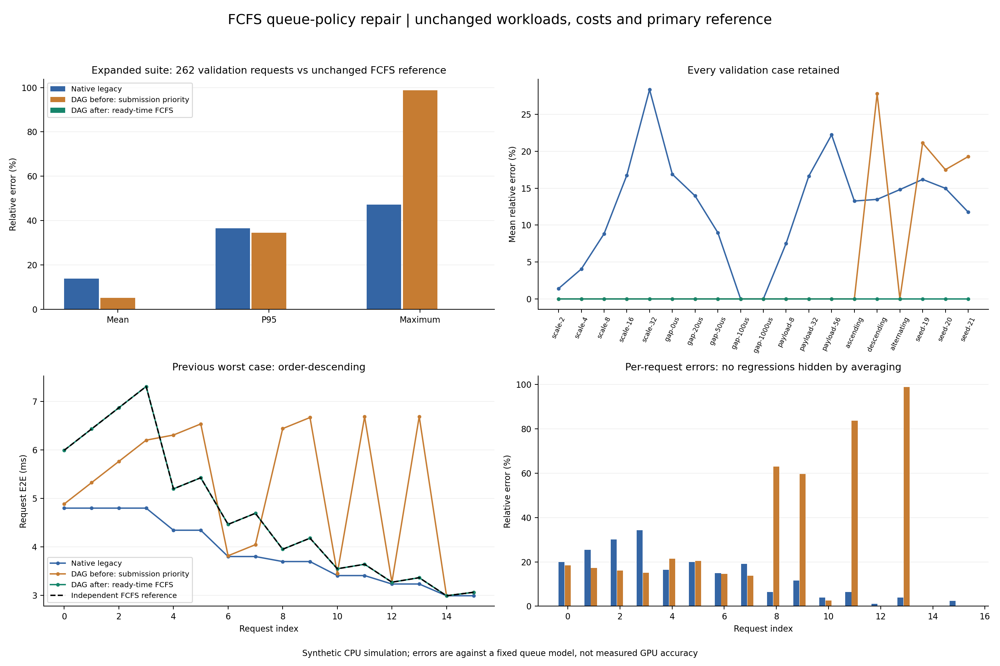

# DAG 就绪队列修复与逐请求不退化验证

本轮针对[扩展实验](DAG_MECHANISM_EXPANDED.md)暴露的排队策略问题，增加可选择的 FCFS 就绪队列。
保留原生 legacy、修复前 DAG 的提交优先级，以及独立 FCFS 模拟参考作为对照。
费用预测器、通信带宽/时延、输入请求和资源容量不因本次修复而改变。

## 1. 修复范围

原执行器按任务提交时获得的 sequence 选择已就绪任务。一个先提交、晚就绪的任务可能越过
已经等待资源的任务。最坏案例 `order-descending` 请求 13 因此在共享端点上被多次插队。

新增 `ready_queue_policy`：

| 配置值 | 选择规则 | 用途 |
|---|---|---|
| `submission` | 按任务提交 sequence | 默认值，保持历史行为和提交优先级目标 |
| `fcfs` | 按首次 READY 时刻，再按提交 sequence | 目标为 FCFS 资源仲裁时启用 |

资源申请失败不会刷新任务的 READY 时刻；运行中的任务不被抢占。相同时刻用原提交 sequence
打破平局。较早任务被无关资源阻塞时，执行器继续尝试其他任务，避免阻塞独立设备。

策略作用于该执行器的所有就绪任务，包括 CPU、GPU 和通信任务；不是只对请求 13 或某个
场景特殊处理，也没有读取请求长度、请求编号、参考完成时间来决定调度。
共享端点的 FCFS 在本轮“一副本一请求”的工作负载中对应独立排队参考；复杂多资源任务的
工作保持调度不等于各资源严格预约队列，也不构成任意系统的 FCFS 等价证明。

PD 初始化重建执行器时保留该策略；动态 MoE 追加的任务也使用相同规则。
资源管理器、任务费用、依赖图格式、宿主事件时钟和原生 legacy 路径均未改动。

## 2. 怎样启用

在传给 `--dag_resource_config` 的现有资源 JSON 中增加字段：

```json
{
  "ready_queue_policy": "fcfs",
  "endpoints": {
    "gpu:0:0:0": "fabric",
    "gpu:0:1:0": "fabric"
  },
  "independent_comm": []
}
```

其中端点映射继续按实际副本/TP/PP 填写。上例只演示一个两阶段副本；不要用它替代完整拓扑。
省略该字段时仍使用 `submission`，现有历史实验不会被悄悄切换口径。
输出 `summary.json` 中记录实际执行的 `ready_queue_policy`。

## 3. 验收条件

“整体不退化”在这里定义为**相对既定独立 FCFS 模拟参考的预测误差不退化**：

1. 所有既有场景和请求都保留，FCFS 参考、费用和资源配置（除策略字段）与历史证据完全一致。
2. 原生 baseline 重新执行后的请求完成时间与历史值一致。
3. 修复后每个请求的绝对误差都不超过修复前 DAG 和原生 baseline，容差为 1ps。
4. 同时报告平均误差、P95、最大值和场景等权平均，不能用均值抵消个别请求退化。
5. 任务恰好完成一次、依赖满足、资源容量区间合法、最终资源和事件清空。
6. 补充未出现在原 23 场景中的固定种子与到达抖动，在两条策略运行前冻结输入和两种参考。

这不是“所有请求预测耗时都更短”的要求。FCFS 会改变服务顺序：一些请求的正确完成时间
应变长，另一些应变短。也不要求它相对提交优先级参考不退化；目标策略不同，正确时间不同。

## 4. 复现

在项目根目录使用阶段八 Python 环境，输出目录必须不存在：

```powershell
$python = ".\.cache\phase8-repro-env\Scripts\python.exe"
& $python scripts/dag_phase8/mechanism_experiment.py --spec configs/dag/phase8/mechanism-expanded.json --ready-queue-policy fcfs --output results/dag/phase8/my-fcfs-expanded-01
& $python scripts/dag_phase8/queue_policy_comparison.py --before-archive docs/dag/phase8/artifacts/20261119-phase8-dag-mechanism-expanded.zip --after-run results/dag/phase8/my-fcfs-expanded-01 --output results/dag/phase8/my-fcfs-comparison-01
```

第二条命令核验历史 ZIP、原始运行 manifest、冻结输入与服务费用，重新计算所有请求的误差，
并独立审计新运行的图、任务和资源区间。出现任何逐请求退化时返回非零状态。
所有原始结果留存，不以重选请求或更换主要参考来消除退化。

## 5. 适用结论的边界

独立参考仍是固定服务费用的确定性端点排队模型。修复后与它一致，只能说明相同假设下的
资源排队计算符合 FCFS。真实硬件是否采用 FCFS、kernel/collective 费用是否准确、流级带宽共享
是否重要，需要独立实测。新增场景也使用相同合成费用，不能视作独立硬件精度验证。
已有工作负载是用于定位问题后的回归样本，补充场景扩展了输入覆盖，但没有引入新的物理模型。
项目整体硬件精度验收不因这一轮修复而自动完成。

## 6. 2026-11-19 实际结果

四次完整实验共执行 96 次原 CLI（包含四次隔离费用探测）；两次历史回归和一组新增负载
共覆盖 38 场景、466 次请求评估。原 7 场景与 23 场景有重复的工作负载条件，不当作独立样本。
新增 8 场景含 128 请求，其中 112 验证、16 对照；四组随机种子为 20261123–20261126，
另含长短交替、反向交替、稀疏混合和独立端点对照。输入在两种策略执行前固定，见
[`mechanism-fcfs-holdout.json`](../../../configs/dag/phase8/mechanism-fcfs-holdout.json)。

### 原最坏请求

`order-descending` / 请求 13 / Prefill 16 tokens：

| 项目 | 原生 legacy | 修复前 DAG | FCFS DAG |
|---|---:|---:|---:|
| 请求 E2E | 3.232936ms | 6.687287ms | **3.363163ms** |
| 相对 FCFS 误差 | 3.8722% | 98.8392% | **数值误差量级** |

FCFS 参考为 3.3631625803174606ms，新 DAG 为 3.3631625803174654ms。
端点等待由 3.454351ms 降至 0.130227ms，通信服务费用仍为 0.094056ms。
消除的约 3.324124ms 全部来自排队顺序，没有修改费用。

### 原 23 场景的所有 262 个验证请求

| 指标 | 原生 legacy | 修复前 DAG | FCFS DAG |
|---|---:|---:|---:|
| 平均相对误差 | 13.8393% | 5.2344% | <1×10⁻¹¹% |
| P95 相对误差 | 36.5288% | 34.4751% | <1×10⁻¹¹% |
| 最大相对误差 | 47.1541% | 98.8392% | <1×10⁻¹¹% |
| 平均绝对误差 | 0.690113ms | 0.220608ms | 数值误差量级 |

所有 311 个请求（含 49 个对照）都匹配原 FCFS 参考：相对修复前 DAG 为
**54 改善 / 257 持平 / 0 退化**；相对原生版本，验证请求为 209 改善 / 53 持平 / 0 退化。
原先相对原生退化的 21 个请求全部消除退化，没有删除任何请求。

### 历史与补充场景

| 工作负载 | 验证/对照请求 | 原生平均误差 | 旧 DAG 平均误差 | FCFS DAG 平均误差 | 相对旧 DAG 改善/持平/退化（全部请求） |
|---|---:|---:|---:|---:|---|
| 原 23 场景 | 262/49 | 13.8393% | 5.2344% | 数值误差量级 | 54/257/0 |
| 原 7 场景 | 18/9 | 4.9767% | 数值误差量级 | 数值误差量级 | 0/27/0 |
| 新增 8 场景 | 112/16 | 13.7244% | 9.0170% | 数值误差量级 | 54/74/0 |

466 次请求评估合计相对旧 DAG **108 改善、358 持平、0 退化**；相对原生版本也无逐请求误差退化。
不将三批相关/重复条件合并成一个精度百分比。
原 23 场景中 26 个请求的新预测耗时变长、28 个变短，但它们的预测误差全部下降。
因此不能把这次结果表述为“调度让每个请求运行更快”。



### 功能、兼容性与证据

- 三批新 FCFS 结果独立审计 **932 张图、47998 个任务**，检查依赖、完成次数、时长、等待和资源占用区间，通过。
- 完整回归共 313 个测试：首次 312 通过，1 项因阶段四子进程没有项目 `PYTHONPATH` 而导入失败。
  按项目路径补齐环境后，该项重跑通过；两次日志/XML、首次失败记录和成功重跑的 CLI 原始输出均保留。
- 默认仍为 `submission`；新增 FCFS 单元覆盖晚就绪插队、相同时刻排序、等待重试、独立资源和动态追加。
  PD 迁移/容量背压和 PD→动态 MoE Decode 在两种策略下均有测试，重建执行器不丢失策略。
- 修复前 23 场景及原 7 场景使用已提交证据包；补充场景的两种策略重新执行。
  原 7 场景参考只兼容旧版 JSON 的类型/策略头部，全部参考数值要求完全相同。
- 历史冻结 workload spec 的 `limitations` 保留原文字，包括旧实验的“no new scheduling policy”；
  本轮实际策略由新增 `execution_ready_queue_policy` 和输出 `summary.json.ready_queue_policy` 明确记录，
  新报告以此为准，不将历史文字解释成本轮没有改变策略。

完整回归命令（同时给旧脚本子进程提供导入路径）：

```powershell
$env:PYTHONPATH = "$PWD;$PWD\vidur-alibabacloud"
& $python -m pytest tests/test_dag_phase1_contracts.py tests/dag -q -p no:cacheprovider
```

补充场景对照：

```powershell
& $python scripts/dag_phase8/mechanism_experiment.py --spec configs/dag/phase8/mechanism-fcfs-holdout.json --ready-queue-policy submission --output results/dag/phase8/my-holdout-submission-01
& $python scripts/dag_phase8/mechanism_experiment.py --spec configs/dag/phase8/mechanism-fcfs-holdout.json --ready-queue-policy fcfs --output results/dag/phase8/my-holdout-fcfs-01
& $python scripts/dag_phase8/queue_policy_comparison.py --before-run results/dag/phase8/my-holdout-submission-01 --after-run results/dag/phase8/my-holdout-fcfs-01 --output results/dag/phase8/my-holdout-comparison-01
```

查看[独立 HTML 对照报告](artifacts/dag-fcfs-fix.html)与[完整证据包](artifacts/20261119-phase8-fcfs-fix.zip)。
证据包含四次运行、三份逐请求对照、测试日志、图表和精确被测源码快照；校验和在同目录 `SHA256SUMS`。
`tested-source/` 为运行时扫描的确切文件，`postprocessing-source/` 单列运行结束后完善的比较/展示工具。
FCFS 修复验证支持“本组输入及参考假设下逐请求不退化”，不构成任意未来负载或真实 GPU 上的全局保证。
