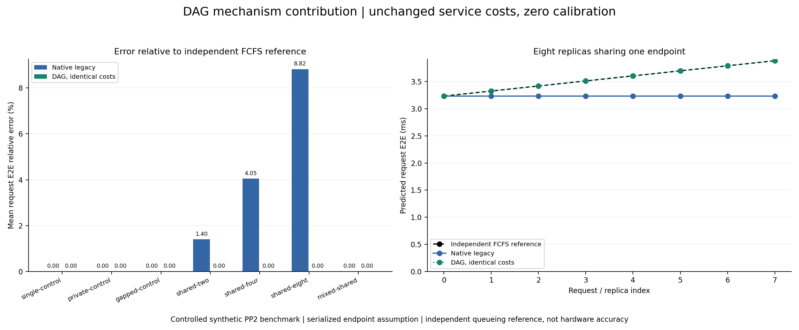

# 同费用下的 DAG 机制贡献：共享通信端点争用

本实验补充“DAG机制本身有什么作用”的证据，与已有的通信费用校准实验分开。
比较原生 `legacy` 与 `dag_expanded`：**同一请求、同一费用表、同一资源配置，零额外校准**。
只检查共享通信端点的等待是否进入请求完成时间。

这是实际原CLI推理请求相对于独立排队模型的机制一致性实验。
计算与网络画像仍是合成数据，不将结果扩大为真实GPU、包级网络或全部推理场景的精度结论。

## 1. 两条被测路径与独立参考

| 角色 | 实现 | 输入与输出 |
|---|---|---|
| 原生基线 | 原CLI的 `legacy` 模式 | 聚合Stage费用推进请求；保留原实现，不人为修改其预测值 |
| DAG改进路径 | 原CLI的 `dag_expanded` 模式 | 使用同样的任务服务耗时，同时申请/释放共享端点许可 |
| 独立参考 | [`queue_reference.py`](../../../scripts/dag_phase8/queue_reference.py) | 仅接受冻结的请求配置和费用表，用Decimal计算FCFS端点排队；不导入SimAI或DAG |

本轮没有使用此前的81.654μs补偿，也没有拟合新的scale、offset或带宽参数。
`--dag_resource_config` 指向同一个文件；原生路径保持原有行为，不执行端点许可约束。
因此比较的是显式资源约束是否改善相对于所声明参考模型的预测，而不是换了费用或改写了基线。

## 2. 场景为什么能够区分两条路径

配置为Llama-2-7b结构、TP=1、PP=2；每个副本有两块独立的逻辑GPU，每副本仅一个请求。
每个请求完整Prefill，Decode=1，表示生成首个token后完成；本实验只评价请求E2E/首token完成，
不评价需要多个输出token的TPOT。
原CLI中未发生的Decode/PD阶段字段可能为空或`inf`，并保留原始警告；本实验仅使用已核验为有限值的
请求E2E及首token完成时间，不将这些不适用字段用于评分。

多个副本的GPU彼此独立，但PP传输可映射到同一个通信端点，容量为一个不可抢占许可。
默认画像的网络公式在实验前指定为20μs加payload/1.25GB/s，作为合成的受限10Gb/s链路背景。
**真正进入所有路径的服务费用均使用原预测器输出，不用该公式重新替换某一条路径的费用。**

独立参考将请求分为“通信前工作→共享端点传输→通信后工作”。由于每副本只有一个请求，
其内部没有其他GPU/CPU争用；唯一跨副本共享的资源是通信端点，所以可以独立求解排队时间。

```text
端点就绪时刻 aᵢ = 请求到达 + Stage0总服务费用 − PP传输费用 − Stage0通信后CPU费用
传输开始 sᵢ     = max(aᵢ, 同端点上一次传输结束)
传输结束 eᵢ     = sᵢ + PP传输费用
请求完成        = eᵢ + Stage0通信后CPU费用 + Stage1总服务费用
```

参考按端点就绪时刻、请求索引排序计算；没有从DAG时间线取等待量，也没有在原生结果上
人工加一个观察到的差值。参考在两条被测路径运行之前生成、冻结。

当前执行器的一般派发优先级按稳定任务提交顺序，不是任意输入下的FCFS网络调度器。
本组场景中相关就绪顺序与该优先级相容；不据此声称执行器在所有混合负载中等价于FCFS。

## 3. 冻结的对照和验证集

实验定义在 [`mechanism-experiment.json`](../../../configs/dag/phase8/mechanism-experiment.json)。

| 场景 | 请求/副本数 | 端点 | 输入与目的 |
|---|---:|---|---|
| single-control | 1 | 共享 | 单请求无争用，检查两条路径保持一致 |
| private-control | 4 | 每副本独立 | 移除共享资源，检查两条路径保持一致 |
| gapped-control | 4 | 共享 | 请求相隔10ms，检查充分错峰后等待消失 |
| shared-two | 2 | 共享 | 16-token Prefill，1μs到达间隔 |
| shared-four | 4 | 共享 | 相同费用下扩大共享资源竞争 |
| shared-eight | 8 | 共享 | 相同费用下继续扩大竞争 |
| mixed-shared | 4 | 共享 | Prefill为8/16/32/48，保留不同输入的结果 |

三个对照场景共9个请求，四个验证场景共18个请求。主要指标是18个验证请求的平均相对误差，
对照结果单列，首个无需排队的请求以及持平/退化样本都保留。
没有根据最后结果修改场景、挑选样本或调整费用。

## 4. 费用相同与参考独立怎样保证

1. 先用原预测器在隔离请求上读取8/16/32/48-token的两阶段费用快照，只记录返回值，不改变它。
2. 生成 `cost-contract.json`。独立参考只读取该表的服务费用，不读取费用探测运行的开始/结束时刻。
3. 用独立脚本生成全部场景的 `reference.json`，写入 `experiment-freeze.json`。
4. 正式运行每个场景的原生和DAG路径，重新捕获原预测器返回值，逐字段与冻结费用表比较。
5. 检查DAG各任务服务费用之和仍等于原Stage聚合费用，禁止额外校准或重复收费。
6. 比较参考、原生、DAG的请求E2E；同时逐条核对DAG通信的就绪、开始、结束及等待时间。

[`capture_cost_cli.py`](../../../scripts/dag_phase8/capture_cost_cli.py)是只读观测包装器：
调用原预测方法，记录其返回值，原样返回；不改变任务耗时、调度事件或时钟。
其作用与运行日志相同，实验不需要修改仿真执行器或旧路径。

## 5. 运行与查看

使用阶段八现有Python环境，无需GPU、WSL或新的C++编译。在项目根目录执行：

```powershell
cd C:\Users\zhongjiahui\Desktop\FinalSimAI\SimAI
$run = "results/dag/phase8/mechanism-" + (Get-Date -Format "yyyyMMdd-HHmmss")
& .\.cache\phase8-repro-env\Scripts\python.exe scripts/dag_phase8/mechanism_experiment.py --output $run
& .\.cache\phase8-repro-env\Scripts\python.exe scripts/dag_phase8/mechanism_display.py --run-dir $run --output "$run-display"
```

第一个命令运行费用探测及7个场景的两条原CLI路径；第二个命令从经过哈希核验的结果生成
PNG/SVG/PDF、Markdown和内嵌图表的HTML。输出目录必须为新目录。
退出码0表示本组同费用机制门槛通过；2表示没有满足改善门槛，全部结果仍保留。
如果执行失败或费用/冻结输入不一致，则拒绝继续评分。

也可把准备和正式验证分开，方便审查冻结输入：

```powershell
& .\.cache\phase8-repro-env\Scripts\python.exe scripts/dag_phase8/mechanism_experiment.py --output $run --prepare-only
& .\.cache\phase8-repro-env\Scripts\python.exe scripts/dag_phase8/mechanism_experiment.py --output $run --run-prepared
```

这两条命令用于一个尚未正式执行的新目录；不要在已完成完整运行的同一目录上重复执行。

## 6. 验收门槛与结论范围

- 两条路径的所有组件费用与冻结表逐字段相同，DAG服务费用无增减，额外校准参数为0。
- 单请求、独立端点和错峰对照没有参考排队，原生与DAG都应与参考一致。
- 所有DAG通信就绪/开始/结束/等待时刻及请求E2E与独立参考在1ps数值容差内一致。
- 验证集原生误差与DAG误差按全部请求计算；改善不能仅来自显示舍入。
- 场景结束后任务/请求完成一次、资源清空、事件队列排空。

通过意味着：**在冻结的共享端点串行服务假设下，DAG把原生聚合路径未计入的资源等待纳入了
实际推理请求时间，因此在相同任务费用下更接近独立排队参考。**
这属于DAG资源建模的贡献证据，不是通信费用校准效果，也不证明硬件或流级网络精度。
流级带宽共享、任意竞争优先级、多请求同副本、持续Decode、PD与MoE仍需各自的参考验证。
默认四场景的项目总体验收不会因本实验而自动通过。

## 7. 2026-11-19实际结果

运行目录为`results/dag/phase8/20261119-dag-mechanism-01/`。
1次隔离费用探测加7个场景各2条路径，共15次实际原CLI运行，全部完成。
费用在原生、DAG和参考之间逐字段相同；所有场景检查均通过。



| 场景 | 类别 | 请求数 | 原生平均相对误差 | 同费用DAG平均相对误差 | 最大参考等待/ms | 改善/持平/退化 |
|---|---|---:|---:|---:|---:|---|
| single-control | 对照 | 1 | 0.0000% | 0.0000% | 0.0000 | 0/1/0 |
| private-control | 对照 | 4 | 0.0000% | 0.0000% | 0.0000 | 0/4/0 |
| gapped-control | 对照 | 4 | 0.0000% | 0.0000% | 0.0000 | 0/4/0 |
| shared-two | 验证 | 2 | 1.3989% | 0.0000% | 0.0931 | 1/1/0 |
| shared-four | 验证 | 4 | 4.0475% | 0.0000% | 0.2792 | 3/1/0 |
| shared-eight | 验证 | 8 | 8.8240% | 0.0000% | 0.6514 | 7/1/0 |
| mixed-shared | 验证 | 4 | 0.0000% | 0.0000% | 0.0000 | 0/4/0 |

18个验证请求汇总：原生平均相对误差为 **4.9767%**，DAG为约 **1.13×10⁻¹³%**，
11例改善、7例持平、0例退化。9个对照请求均持平。
表中的0.0000%是舍入显示，原始浮点差异保留；27个请求的DAG最大绝对误差约6.94×10⁻¹⁷秒，
在预先声明的1ps数值容差内。这表示与该精确排队参考一致，不表示真实硬件误差为零。

最直观的例子是shared-eight的最后一个请求：

| 项目 | 请求E2E |
|---|---:|
| 原生聚合路径 | 3.232936ms |
| 独立FCFS参考 | 3.884325ms |
| 同费用DAG路径 | 3.884325ms |

差值约 **0.651390ms**，正好是该请求等待共享端点的时间。
这段时间由DAG实际申请资源、等待、释放和事件推进产生，没有加入新的任务服务费用。

shared-four与private-control使用相同请求，只改变端点是否共享：独立端点时差异消失。
gapped-control保持共享端点但错开请求，差异也消失，支持“改善来自争用等待建模”的归因。
mixed-shared虽然保留在预先确定的验证集中，但这次实际没有排队，四例均持平，未从统计中删除。

可打开[独立HTML展示](artifacts/dag-mechanism.html)，或下载[原始证据包](artifacts/20261119-phase8-dag-mechanism.zip)。
证据包包含冻结配置/费用、独立参考、两条原CLI命令与输出、任务时间线、测试与被测文件快照。
从已提交证据重新生成展示无需重跑仿真：

```powershell
& .\.cache\phase8-repro-env\Scripts\python.exe scripts/dag_phase8/mechanism_display.py --output results/dag/phase8/my-mechanism-display-01
```

本轮新增的独立参考与冻结校验测试已通过；费用相等、通信四个时刻、完成回调、依赖、
资源释放及队列排空另由真实CLI结果和交付审计检查。完整测试/审计记录保留在证据包中。
聚焦回归共31项通过，包含本轮新增5项；交付审计核对了54张图、2781个任务的完成次数、
依赖顺序及资源区间，所有检查通过。
