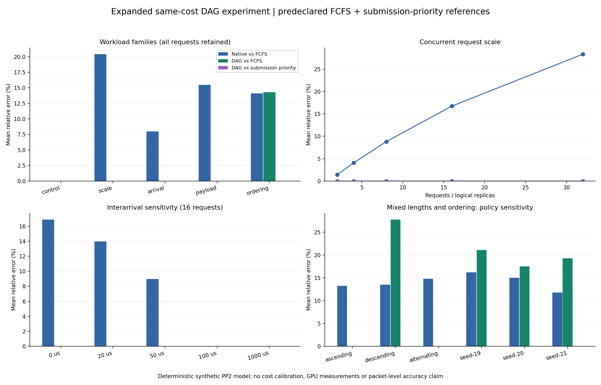
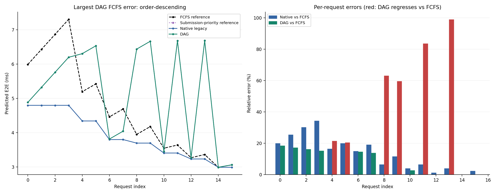

# 扩展同费用DAG实验：请求规模、到达间隔与调度顺序

后续已增加可配置 FCFS 就绪队列，并完成逐请求不退化回归，见[修复报告](DAG_FCFS_FIX.md)。
本文件保留修复前提交优先级版本的原始结果。

这轮在[首组机制实验](DAG_MECHANISM_COMPARISON.md)基础上扩大覆盖范围。
原来的7组、27个请求保留为历史结果；本轮单独冻结23个场景、311个请求，
其中262个验证请求、49个对照请求，不与上一轮混合计算误差。

原生`legacy`和`dag_expanded`仍使用相同的预测器费用和资源配置，新增校准参数为0。
核心执行器与原生路径未改动；扩展的是工作负载、实验记录与参考策略诊断。
两条路径的backend均为`vidur`，费用来自相同合成画像和原预测器。
这与TP8的analytical/ns-3费用校准实验是不同配置和参考，误差不能混合汇总。

## 1. 为什么不只重复相同请求

| 维度 | 本轮覆盖 | 检验的问题 |
|---|---|---|
| 并发规模 | 2、4、8、16、32请求/逻辑副本 | 争用增大后是否仍正确计入等待 |
| 到达间隔 | 0、1、20、50、100、1000μs，另有10ms错峰对照 | 从突发到稀疏时，差异是否随争用变化 |
| 请求长度 | 8、16、24、32、40、48、56-token Prefill | 不同服务费用和通信量下是否一致 |
| 请求顺序 | 长度升序、降序、长短交替、三组固定随机种子 | 任务提交优先级与FCFS是否产生不同结果 |
| 独立对照 | 单请求、8/32副本独立端点、8副本错峰 | 无争用时是否保持原行为 |

随机场景使用种子20261119、20261120、20261121，每组16请求。
随机输入和累积到达抖动已展开为明确数组，保存在
[`mechanism-expanded.json`](../../../configs/dag/phase8/mechanism-expanded.json)，运行前冻结。
不通过不断更换种子选择更好的结果。

每个逻辑副本仍只有一个完整Prefill请求，TP=1、PP=2、Decode=1；最大32副本对应64块逻辑GPU，
全部在CPU上推进模拟，不需要64块真实GPU。该边界使共享通信端点成为唯一跨副本争用资源。
本轮不扩展同副本多请求、持续Decode、PD、MoE或真实硬件精度。

## 2. 两种参考都在观察结果之前确定

主要参考继续使用独立FCFS端点排队模型，保持与首轮的比较口径。
同时提前生成一个独立“按任务提交优先级选取就绪请求”的参考，作为策略诊断：

| 参考 | 已就绪且等待同一端点的任务怎样选择 | 在报告中的角色 |
|---|---|---|
| FCFS | 先到达端点者先服务，同一时刻按请求索引 | **主要误差与改善/退化统计** |
| 提交优先级 | 端点释放时，选择已就绪任务中提交索引最小者 | 次要诊断，检验是否源于调度策略差异 |

DAG执行器一般按稳定任务提交顺序派发，而不保证所有混合负载都符合FCFS。
因此长短请求可能出现DAG与FCFS参考不一致；这不应导致程序停止、删除样本或更换主要参考。
本轮保留所有差异，并输出其与第二种参考的对照。

两个参考都只读取冻结的工作负载和预测器费用，不读取DAG图、原生完成时间或DAG时间线。
参考代码独立于仿真器，见[`queue_reference.py`](../../../scripts/dag_phase8/queue_reference.py)。
参考服务费用没有变化；变化的只是队列中已经就绪的任务的选择顺序。

## 3. 统计口径

- **按请求汇总**：262个验证请求的平均相对误差，保留每个请求的改善/持平/退化。
- **按场景等权汇总**：对19个验证场景分别计算平均误差，再等权平均，避免大场景主导唯一结论。
- **按工作负载族汇总**：规模、到达、长度和顺序分开报告；对照也单列。
- **P95与最大误差**：展示误差分布的尾部，不仅展示均值。
- **策略一致性**：FCFS不匹配数量与提交优先级不匹配数量同时报告。

这些请求共享端点、费用与确定性模型，彼此相关，不能声称是311个独立硬件测量样本。
P95是构造工作负载中的误差分位数，不是统计置信区间。
本轮数据分布与首轮不同，不能只用两轮汇总百分比的升降判断实现变好或变坏。

## 4. 复现命令

在项目根目录使用阶段八现有Python环境：

```powershell
cd C:\Users\zhongjiahui\Desktop\FinalSimAI\SimAI
$run = "results/dag/phase8/mechanism-expanded-" + (Get-Date -Format "yyyyMMdd-HHmmss")
& .\.cache\phase8-repro-env\Scripts\python.exe scripts/dag_phase8/mechanism_experiment.py --spec configs/dag/phase8/mechanism-expanded.json --output $run
& .\.cache\phase8-repro-env\Scripts\python.exe scripts/dag_phase8/mechanism_expanded_display.py --run-dir $run --output "$run-display"
```

共运行一次隔离费用探测与23个场景各两条原CLI路径，即47次CLI执行。
不会修改原生路径、DAG执行核或通信校准参数。输出目录必须是新目录。

退出码0表示全部严格参考门槛通过；2表示完整实验已保留结果，但主指标未改善或存在参考策略差异；
1表示功能/运行失败。不能只根据退出码2就删除结果或重新选样本。
费用不一致、冻结输入被修改或请求没有正常完成时仍会拒绝继续评分。

## 5. 输出怎样查看

| 文件 | 内容 |
|---|---|
| `mechanism-report.json` | 按请求/场景汇总、P95、最大值、策略差异及独立功能状态 |
| `request-comparison.csv` | 所有311请求的两种参考、原生与DAG预测、主要误差及次要误差 |
| `case-summary.csv` | 23个场景各自的误差和改善/持平/退化数量 |
| `group-summary.csv` | 五类工作负载的结果 |
| `cases/*/checks.json` | 功能检查与参考不匹配分开记录，保留通信四个时刻的差异 |
| `experiment-freeze.json` | 正式对照运行之前冻结的配置、费用与两种参考哈希 |

展示脚本输出两张图：第一张覆盖全部工作负载族、规模、到达与顺序，第二张选择
**DAG相对FCFS平均误差最大**的验证场景，展示逐请求结果；红色表示相对原生发生退化。
该选择规则只用于突出诊断，不改变汇总样本集合。

## 6. 2026-11-19实际结果

运行目录：`results/dag/phase8/20261119-dag-mechanism-expanded-01/`。
一次隔离费用探测加46次原CLI场景运行全部完成。23个场景的费用和功能检查均正常，
但4个场景与主要FCFS参考不完全一致，因此结果状态为`improved_with_reference_differences`，
没有标记为“全部严格参考门槛通过”。正式验证墙钟约427.12秒，不包含先前准备探测，
该数值是本机CPU仿真开销，不是模型请求耗时。

### 主要结果：参考保持FCFS

| 指标（262个验证请求） | 原生legacy | 同费用DAG |
|---|---:|---:|
| 按请求平均相对误差 | 13.8393% | **5.2344%** |
| 按19个场景等权平均相对误差 | 12.1123% | **4.5112%** |
| 平均绝对误差 | 0.690113ms | **0.220608ms** |
| 相对误差P95 | 36.5288% | 34.4751% |
| 最大单请求相对误差 | 47.1541% | **98.8392%（退化）** |

逐请求为**188例改善、53例持平、21例退化**。49个无争用对照请求全部持平。
均值改善并不代表尾部和每个请求都改善，不能省略最大误差退化这一项。



| 工作负载族 | 验证请求数 | 原生平均相对误差 | DAG平均相对误差 | 改善/持平/退化 |
|---|---:|---:|---:|---|
| 并发规模 | 62 | 20.4072% | 数值误差量级 | 57/5/0 |
| 到达间隔 | 80 | 7.9657% | 数值误差量级 | 45/35/0 |
| 输入长度 | 24 | 15.4705% | 数值误差量级 | 21/3/0 |
| 混合输入与顺序 | 96 | 14.0845% | **14.2856%（略退化）** | 65/10/21 |

前三类验证了资源排队建模的作用；顺序敏感性实验则揭示了现有派发策略与FCFS不一致时的限制。
四个不匹配场景为`order-descending`及三个`order-random-*`，共54个请求与FCFS存在差异。
这些场景和21个退化请求均完整保留。

### 策略诊断：第二种参考不替代主指标

| 独立参考 | 原生平均相对误差 | DAG平均相对误差 | 用途 |
|---|---:|---:|---|
| FCFS | 13.8393% | 5.2344% | 主要对照，保留全部退化 |
| 提交优先级 | 15.2330% | 约1.36×10⁻¹³% | 提前冻结的次要诊断 |

311个请求的DAG完成时间均与提交优先级参考在1ps容差内一致。
交付审计也逐条核对通信就绪/开始/结束/等待四个时刻，全部匹配该次要参考。
这支持差异来自队列选择策略，而不是偷偷改变费用；不能用第二行的低误差覆盖第一行的主要结果。

最差单请求在`order-descending`中，索引13、Prefill=16：

| 项目 | 请求E2E |
|---|---:|
| FCFS参考 | 3.363163ms |
| 原生legacy | 3.232936ms |
| 提交优先级参考 | 6.687287ms |
| DAG | 6.687287ms |

相对FCFS，原生该请求误差3.8722%，DAG误差98.8392%。在当前提交优先级下，它被其他已就绪任务延后；
FCFS则较早服务它。如果目标系统采用FCFS，就不能把这个DAG结果称为更准确。



## 7. 查看、校验与交付

- [独立HTML报告](artifacts/dag-mechanism-expanded.html)：全部23个场景与两张图，保留退化。
- [完整原始证据包](artifacts/20261119-phase8-dag-mechanism-expanded.zip)：冻结输入、两种参考、两条路径输出、差异、测试及被测文件快照。
- 校验和位于同目录`SHA256SUMS`。原7组实验的证据包保持不变。

只重算图表，无需重新运行47次CLI：

```powershell
& .\.cache\phase8-repro-env\Scripts\python.exe scripts/dag_phase8/mechanism_expanded_display.py --output results/dag/phase8/my-expanded-display-01
```

聚焦回归36项通过，包含新增的队列策略差异、明确到达时刻、冻结规模/随机种子及尾部误差测试。
原7组FCFS参考数值另有兼容性测试保持不变。交付审计检查622张图、32033个任务的依赖、
完成次数、资源区间和请求指标，所有功能检查通过；FCFS差异作为模型结果记录，没有混入功能失败或被隐藏。

目前可支持的结论是：**相同费用下，资源等待建模改善了本组工作负载的总体预测；
混合请求的队列策略会显著影响个别请求，尚不能宣称DAG对任意FCFS目标都更准确。**
如果后续目标系统明确采用FCFS，应单独设计并验收可配置的端点队列策略；本轮没有修改执行器来迎合参考。
