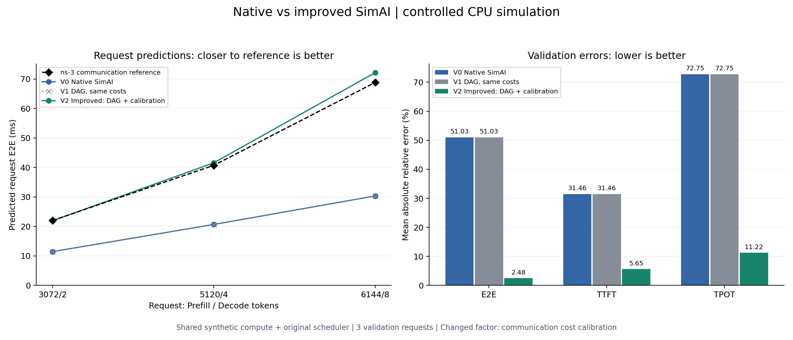

# 原生与改进版 SimAI：模型仿真误差对照

这份文档用于演示和验收：同一批请求，原生路径预测多少，改进版本预测多少，
各自距离参考值有多远，以及误差降低来自哪项改动。

本轮三个验证请求的 E2E 平均相对误差从 **51.03% 降至 2.48%**。
参考是 CPU 上实际运行的 ns-3 通信模型，计算画像为各路径共享的合成画像。
该结论限定于本页的受控模拟场景，不等同于真实 GPU 性能预测精度。

## 1. 原生和改进版本分别指什么

| 标记与图中颜色 | 名称 | 实际运行路径 | 相对于原生的改动 |
|---|---|---|---|
| 黑色虚线 | 模拟参考 | `legacy + simai_simulation` | 采用新运行的 ns-3 通信结果；共享同一计算画像和原请求调度器 |
| V0，蓝色 | **原生基线** | `legacy + simai_analytical` | 保留原有执行路径，使用未校准的 analytical 通信费用 |
| V1，灰色 | **仅 DAG，同费用对照** | `dag_expanded + simai_analytical` | 接入 DAG，计算和通信费用保持与 V0 一致 |
| V2，绿色 | **改进版：DAG＋通信费用校准** | `dag_expanded + simai_analytical` | 在 DAG 路径中使用仅由校准请求拟合、随后冻结的通信固定开销 |

这里的“原生”指**当前仓库保留的 `legacy` 执行路径**，不是重新检出一个完全未修改的上游版本。
原生与改进路径在同一套实验代码和相同模型/请求/拓扑配置下运行，避免跨版本环境差异干扰比较。

V1 是必要的对照：如果只展示 V0 和 V2，容易把通信参数校准的收益误解为 DAG 调度本身的收益。
本轮 V0 和 V1 几乎重合，说明这个串行请求场景中的误差改善主要来自 V2 的通信费用校准。

另有[同费用DAG机制贡献实验](DAG_MECHANISM_COMPARISON.md)，在共享通信端点争用场景中，
固定费用比较原生与DAG，已观察到DAG计入排队等待后更接近独立FCFS参考。
两组实验的配置和参考不同，结果分别报告，不合并平均误差。

## 2. 图表与实际结果



左图：每个请求的参考与预测 E2E，**越接近黑色参考线越好**，不是数值越小越好。
右图：三个验证请求的平均相对误差，**柱子越低越好**。
图中文字采用英文以兼容未安装中文字体的 Linux 环境，V0/V1/V2 与上表一一对应。

| 指标 | V0 原生基线 | V1 仅 DAG，同费用 | V2 改进版 | V2 改善/持平/退化 |
|---|---:|---:|---:|---|
| E2E 平均相对误差 | 51.03% | 51.03% | **2.48%** | 3/0/0 |
| TTFT 平均相对误差 | 31.46% | 31.46% | **5.65%** | 3/0/0 |
| TPOT 平均相对误差 | 72.75% | 72.75% | **11.22%** | 3/0/0 |

E2E 绝对误差的平均值（MAE）从 **23.031ms 降至 1.432ms**。
E2E 是本轮冻结的主要指标；TTFT 与 TPOT 为补充指标，不能只挑改善最多的一项汇报。

| 验证请求 Prefill/Decode | 参考 E2E/ms | V0 原生/ms | V1 仅 DAG/ms | V2 改进/ms | V0 相对误差 | V2 相对误差 |
|---|---:|---:|---:|---:|---:|---:|
| 3072/2 | 22.029 | 11.463 | 11.463 | 21.914 | 47.96% | 0.52% |
| 5120/4 | 40.731 | 20.679 | 20.679 | 41.583 | 49.23% | 2.09% |
| 6144/8 | 68.820 | 30.344 | 30.344 | 72.151 | 55.91% | 4.84% |

V2 的后两个请求仍然预测偏高，脚本保留逐样本的带符号偏差，未删除这些样本。
“误差降低”是预测更接近参考值；这里没有证明真实推理服务运行更快。

## 3. 参数怎样得到，误差怎样计算

配置为 Llama-2-7b 结构、逻辑8×H20、FP16、TP=8、PP=1、EP=1，每次运行一个请求。
参考与所有预测使用同一组合成计算画像和原请求调度器。实验只改变通信模型与校准参数。

校准请求为 **2048 Prefill / 2 Decode**，只用于估计每次 collective 的固定通信开销：

```text
offset = max(0, (参考校准请求 E2E − 原生校准请求 E2E) / 该请求的 TP 通信任务数)
       = 81.654 μs / collective
```

冻结该参数之后，用3072/2、5120/4、6144/8三个请求验证。
**校准行不参与验证集误差汇总**，也不会把验证请求的参考耗时直接填入改进版本。
所有请求共享单 token Decode 的通信输入，因此这里只留出了 Prefill 大小和完整请求输入。

```text
单样本绝对误差 = |预测耗时 − 参考耗时|
单样本相对误差 = 单样本绝对误差 / 参考耗时
平均相对误差   = 三个验证样本的相对误差之和 / 3
```

## 4. 一条命令重新生成展示

对应脚本为 [`compare_versions.py`](../../../scripts/dag_phase8/compare_versions.py)。
它默认读取仓库已提交的证据ZIP，核对ZIP校验和、run manifest、样本覆盖、执行路径标记，
并把CSV数值与实际CLI请求完成时间和指标逐项核对，然后重新计算误差、绘图。
**该命令是证据重算与展示，不会重新运行模型仿真，也不需要 GPU 或 WSL。**

在本机 PowerShell 的项目根目录执行：

```powershell
cd C:\Users\zhongjiahui\Desktop\FinalSimAI\SimAI
& .\.cache\phase8-repro-env\Scripts\python.exe scripts/dag_phase8/compare_versions.py
```

脚本会打印新建报告目录及三项误差对比。打开其中的 `report.html` 即可展示，
HTML已内嵌图表，可单独分享。当前生成的[独立HTML报告](artifacts/version-comparison.html)也已随文档提交。

如果使用普通 Python，新建环境只需 Python 3.10+ 和 matplotlib；本次验证的绘图版本为3.10.8：

```powershell
python -m pip install matplotlib==3.10.8
python scripts/dag_phase8/compare_versions.py
```

也可指定一个新的输出目录，已有目录会被拒绝覆盖：

```powershell
python scripts/dag_phase8/compare_versions.py --output results/dag/phase8/my-version-comparison-01
```

若要展示以后重新运行的实验，指定其完成目录：

```powershell
python scripts/dag_phase8/compare_versions.py --run-dir results/dag/phase8/20261118-simulated-reference-01
```

`--run-dir` 模式仍会检查原始文件哈希和实际CLI数值，不会直接相信手工编辑过的汇总表。
它面向同一套 `simulated_reference.py` 生成的受控TP8稠密实验，不是任意模型的通用精度评估器。

## 5. 输出文件与验收方法

| 输出 | 用途 |
|---|---|
| `report.html` / `report.md` | 版本说明、结果表和结论边界 |
| `version-comparison.png` | 文档、PPT直接使用的图片 |
| `version-comparison.svg` / `.pdf` | 可缩放、可导出的矢量图 |
| `per-sample-errors.csv` | 每个验证请求、每个指标、每个版本的误差与带符号偏差 |
| `metric-summary.csv` | 重新计算的平均相对误差、MAE、改善/持平/退化数量 |
| `display-manifest.json` | 证据身份、展示脚本哈希和输出文件哈希，注明 `simulation_rerun=false` |

验收时核对三件事：V0/V1/V2的路径标记正确；汇总只包含三个验证请求；
重新生成的E2E对比为51.03%→2.48%，同时完整展示TTFT、TPOT和全部逐样本结果。
脚本即使遇到退化也会如实输出，不会过滤不利样本。

若要从头生成新的模拟参考和请求结果，执行[模拟参考实验文档](SIMULATED_REFERENCE.md)的
“生成与复现”步骤，再将新目录传给本脚本。真正的仿真入口是
[`simulation_backend.py`](../../../scripts/dag_phase8/simulation_backend.py) 和
[`simulated_reference.py`](../../../scripts/dag_phase8/simulated_reference.py)，与本页的绘图脚本分开。

## 6. 结论范围

可以表述为：**在固定合成计算画像与原调度器的TP8稠密请求中，改进版相对ns-3通信参考模型的
验证集E2E平均相对误差，从原生路径的51.03%降至2.48%。**

本轮只包含一个校准请求和三个验证请求；尚未验证计算画像、调度器、真实GPU、
多请求争用、PD、动态MoE及联合场景的预测精度。证据来源和完整原始记录见
[`20261118-phase8-simulated-reference.zip`](artifacts/20261118-phase8-simulated-reference.zip)，
校验和见同目录的`SHA256SUMS`。

本次展示脚本新增7项测试已通过，覆盖证据校验、校准样本排除、退化记录、零参考值、
样本缺失及ZIP/本地结果两种读取方式。展示结果已在两种读取方式下核对一致；
本次没有修改仿真执行器、费用校准参数或原始实验数据。
