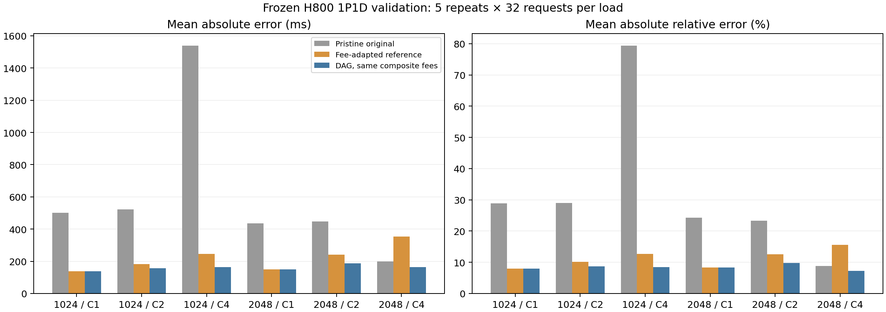

# 双 H800 真实1P1D推理与SimAI DAG预测实验汇报

编制日期：2026-11-27（Asia/Shanghai）。正式运行：`formal-validation-composite-20261126-01`。本报告基于已完成的30轮、960条请求及其冻结后回放，不把预验收结果混入正式评分。

## 1. 完成范围与主要结论

30轮真实采集、960条请求均成功且可对账；30轮选定预测尝试均通过当前费用域、token、DAG依赖、任务收费及资源互斥断言。没有以DAG必须改善、误差趋零、批次完全相同为验收门槛。真实测量结束后GPU服务已停止，后续仅CPU执行仿真和评分。

六个负载档等权、每档五次重复等权的平均相对误差：未修改原版 **32.281%**；费用适配参考版 **11.227%**；同组合费用DAG **8.418%**。后两者同费对照的总量不能代替分档结果。按轮MAE差超过1ns的描述性标准，20轮改善、0轮退化、10轮差异不超过1ns；此描述不修改冻结评分中的零容差。

当前结论只适用于本次模型、硬件、服务实现、固定输入和负载。自然组批、资源占用近似等同时影响预测，不能把全部误差变化单独归因于DAG依赖图机制，也不能外推到其他模型、MoE、多机或NVLink系统。

## 2. 原计划与实际执行对照

| 原计划要求 | 实际执行与限制 |
|---|---|
| 同机双H800、FP16、TP1、一Prefill一Decode | 已执行。H800 PCIe，SYS拓扑，NCCL SHM/direct/direct；不假定NVLink。 |
| Llama-2-7B，来源和哈希明确 | NousResearch/Llama-2-7b-hf，固定revision；不能宣称与Meta官方仓库逐字节相同。 |
| 512/64 calibration，串行/并发2，各3×32 | 192条已归档。最初串行采集不足由补充采集合并，原件与关系保留，不能伪称一次无故障完整采集。 |
| 独立费用、每点10次预热及30次测量 | 最终worker画像1024点，receiver两长度各10+30。与正式E2E窗口分开；没有用正式完成时间拟合费用。 |
| 1024/2048×128，C1/C2/C4，各5×32 | 30轮/960请求已完成；固定seed随机顺序，逐轮实际到达重放。 |
| 未修改原版与同费DAG | 改为明确三列预测：未修改原版保留原费用；另列仅费用适配参考版，与DAG共享组合费用。不得混称基线。 |
| GPU完成/KVReady事件、每档正式波次独立profiler | 正式采用轻量host事件。精确GPU KVReady和正式每档事后profiler未完整交付；既有同步诊断不能重标为该证据。 |
| 冻结、评分、失败保留、证据回传 | 冻结后正式测量；评分规则不因结果改变。所有已知失败与中断另存，完成尝试选择以有效性为准。大文件通过Release分段回传。 |

因此本实验符合核心测量矩阵，并落实后续授权的费用方案；不能笼统签署“完全满足最早计划全部项目”。缺失精确事件与profiler证据限制机制归因，不删除这些缺项来美化验收。

## 3. 真实环境、模型及服务

真实采集平台为Ubuntu22.04，同机两张H800 PCIe80GB。采集时配额40CPU核、240GB内存，数据盘150GB。后续曾切换0.5核/2GB无卡模式，因CPU配额过小又恢复计算资源；这仅影响仿真运行时间，不重采正式请求、不改变冻结输入或费用。

服务环境：vLLM0.8.5 V0；torch2.6.0+cu124；CUDA运行时12.4；NCCL2.21.5；transformers4.51.3；tokenizers0.21.1。驱动支持CUDA版本、工具包及PyTorch运行时是不同概念，版本差异本身未触发重装。完整版本表以support证据包为准。

模型revision：`8efe6c9b93655b934e27bd9981e3ec13e55aee9d`。两个Safetensors分片SHA256：

```
4ec71fd53e99766de38f24753b30c9e8942630e9e576a1ba27b0ec531e87be41  model-00001-of-00002.safetensors
41780b5dac322ac35598737e99208d90bdc632a1ba3389ebedbb46a1d8385a7f  model-00002-of-00002.safetensors
```

FP16、TP1、eager；每个服务max_num_seqs=4，max_model_len=4096，max_num_batched_tokens=4096；prefix cache和chunked prefill关闭；PyNcclConnector、KV buffer8GiB。固定temperature0、top_p1、seed0、ignore_eos=True、min_tokens=max_tokens=128。原始配置保持不改；`--generation-config vllm`避开源generation_config中越界PAD32000，模型config有效PAD0。RoPE theta10000、无scaling，实际整模型执行自然包含RoPE。

输入seed20261126；tokenIDs直接提交，BOS1，其他ID范围4..31999，逐请求内容、输入哈希和分组保留。预热与正式记录分开；每轮预热使用该轮前4条的相同token内容但不同请求ID，prefix cache关闭并等待KV释放，故不是独立随机内容。此点如需严格独立预热输入，应在新协议另行采集，不能改写本轮原件。

## 4. 版本、比较角色及费用

| 角色 | 身份 | 可用于何种比较 |
|---|---|---|
| pristine original | `cef83f9ddd96540e3e9f48934f11335d52d54fce`，独立检出不改 | 原实现+原费用的参照，缺陷与不完整费用保留 |
| fee-adapted reference | 运行同原版调度，仅通过冻结adapter更换费用 | 与DAG做共享组合费用对照；不是未经修改原版 |
| DAG same composite fees | `b3ce1b661d39510192652457ce1266ebfa417b1b`，原版predictor覆盖及共同fee adapter | 当前候选DAG，未加入额外就绪修复或固定组批变体 |

DAG提交包含dev-finalize `63b9a8d05fe02ef3d04ab9a6ceb9153885173b0a`祖先；HEAD、overlay、实际源码文件及adapter哈希均冻结。冻结文件SHA256：`0641087e94dec29ba93172d74454e1f5a90c71fc2ed6f5fce278a7741c7b2313`，冻结时间2026-11-26 23:20:56+08:00。387个源码/输入/服务/费用文件绑定，模型大分片另核验SHA256。

历史缺费键去版本前缀后是6个：attention Prefill等效chunk2896；Decode batch3 context2112/2176；Decode batch1/2/4 context2176。2896没有用于整模型测量。最终按真实输入长度、实际batch、phase、真实context建表；Decode在测得uniform上下文点之间线性插值，拒绝外推。混合上下文用实际平均context查询uniform画像是明确近似，不能宣称相同均值等价于相同物理费用。

三阶段唯一调用：

1. **生产端Prefill**：worker组合从prepare输入到execute后设备同步，含embedding、层计算、RoPE、KV写入、head、采样和内部等待；engine schedule/output为分开测得的顺序区间。旧layer/norm/RoPE/head/sampler/prepare子费归零。
2. **KV及消费端首token**：每请求一次组合，从消费端prepare前同步后开始，含接收、安装、bypass head/采样，到execute后设备同步。替换旧带宽费用；不再加install、consumer首token、head、sampler、prepare子费。producer生成后丢弃的token工作与consumer首token工作确实分别发生，二者不能互相抵消。
3. **消费端token2–128**：127轮正常Decode，按实际组批查worker组合，engine schedule/output各一次；不再对token1收费。

两长度receiver组合分别来自独立串行10+30测量；每请求组合不代表并发共享批次真实耗时。用于旧传输公式的小数“带宽”只是费用系数，不是物理链路带宽。worker画像用8192token预算以直接测到实际batch4 Prefill，正式服务仍是4096；费用只在仿真实际形成的batch调用。所有raw样本及测量脚本随support包保留。

**资源占用是待验证近似**：worker同步host/device整段占一个GPU permit；KV组合整段占用既有源/目标GPU和端点，可能过度保守；engine CPU资源沿用原候选。内部等待计入组合一次，资源等待作为排队记录而不是第二笔服务费。没有按正式误差选择资源开关或新调度规则。

## 5. 事件、计时边界与数据有效性

每轮预热→router/worker空闲观察→32条真实请求→逐请求router与token对账→worker/PD host事件对账→轮后空闲。空闲检查包括running/waiting队列、GPU KV占用和router inflight；未导出的optional swapped/CPU cache指标保留null。低GPU利用率不单独作为空闲证明。host send/recv与bypass返回不是精确GPU完成或无残留connector队列的独立证明。

主实测指标是router stream complete-arrival；预测是最后modeled batch end减去同一实际router arrival，未加入尾部补偿。预定发送、客户端实到、首token、完整响应时间均保留，CPU/GPU事件边界不混称。router/IPC/stream尾部及consumer bypass engine开销未建模，残差留在误差中，既不扣除也不拟合。

真实consumer共128个host步骤：一个KV bypass首token步骤和127个后续Decode；仿真Prefill记token1后有127轮Decode。token总数与轮数一致不代表首token物理位置相同；组合KV费用显式覆盖consumer首token，避免漏费。

所有选定完成回放检查：实际到达一致；每请求输入/输出正确；DAG无早于依赖执行；每个task完成一次；每批一个正值worker组合；每请求一个receiver组合且无首token子费；同配对batch费用一致；资源区间不超容量；等待算术成立；跨波积压如实报告。原版提前组批缺陷保留在原版与费用适配参考中，不用修复版冒称原版。

## 6. 正式结果

| 输入/并发 | 重复×请求 | 原版MAE ms | 同费参考MAE ms | DAG MAE ms | 同费参考→DAG MRE | MAE变化 | 实测轮均E2E标准差 ms |
|---|---:|---:|---:|---:|---|---:|---:|
| in1024-c1 | 5×32 | 500.930 | 138.794 | 138.794 | 8.005% → 8.005% | -0.000% | 3.874 |
| in1024-c2 | 5×32 | 522.491 | 183.403 | 156.429 | 10.178% → 8.679% | +14.708% | 8.749 |
| in1024-c4 | 5×32 | 1538.059 | 245.406 | 164.392 | 12.638% → 8.467% | +33.012% | 6.866 |
| in2048-c1 | 5×32 | 435.519 | 150.525 | 150.525 | 8.363% → 8.363% | -0.000% | 8.669 |
| in2048-c2 | 5×32 | 447.166 | 241.539 | 187.457 | 12.593% → 9.772% | +22.391% | 7.922 |
| in2048-c4 | 5×32 | 199.472 | 354.389 | 164.366 | 15.587% → 7.225% | +53.620% | 11.379 |

MRE=逐请求abs(predicted−actual)/actual的均值；MAE单位秒。先按重复轮次汇总，再对每档五轮等权。表中“MAE变化”为同费参考到DAG的相对下降，正值表示改善。实测标准差是五个轮均serverE2E的样本标准差，不能当成960个独立重复的标准误，也不是独立机制因果证明。

冻结helper沿用历史`preacceptance_not_validation`和通用scorer `blocked`字段，不能把这些旧标签当作本轮重新分类或完整实验验收。正式身份来自冻结输入manifest和30个run_id；本报告的完整性核验单独验证冻结文件、30轮对账和30个选定回放断言。数学评分原件及其旧标签一并保留，不改写历史文件。



冻结评分tie_tolerance_s=0，原始逐请求分类为：同费参考对DAG **{'improved': 783, 'degraded': 168, 'tie': 9}**；原版对DAG **{'improved': 914, 'degraded': 46}**。串行浮点舍入差可能在零容差下被分为改善/退化，必须同时看实际误差差值。报告开头的“≤1ns”只用于数值精度描述，不改变原评分CSV。

客户端E2E、TTFT、TPOT分档汇总见`client-metrics-by-load.csv`。TPOT=(client_complete−client_first_token)/(128−1)，完整响应边界包括结束标记与流结束，不等于GPU内核时间。

逐轮与逐请求数据见`fee-adapted-reference/`、`pristine-original/`和`three-way-scores.csv`分段备份；波动数据见`measured-variability-per-repeat.csv`。需要重点检查`effect-versus-variability.json`：改善是否超过本轮观测的实测轮均波动，不能用单轮或总体平均掩盖某档退化。

## 7. 失败、中断、运行时间与备份

首轮正式CPU回放因CPU环境缺aiohttp在启动阶段失败；改用已有服务Python做编排，实际仿真子进程仍用冻结CPU Python，费用/源码/输入不改。用户关机时已完成7轮，停止专属进程组并保留第8轮partial目录；无卡模式0.5核/2GB再次尝试后随重启中断。恢复40核后外部编排并行3个独立轮次，不改变各轮到达、参数或调度。失败/中断文件没有覆盖，新尝试另建目录；选定完成尝试由有效性断言决定，不按误差筛选。

正式GPU采集30/30、960/960成功；上述失败属于编排/仿真尝试，不能记为真实请求失败。全部尝试路径见`overall-summary.json`。真实trace不重采，费用没有因正式评分更新，未做第二次选优。

30轮原始数据已独立备份到[raw Release](https://github.com/SimulLM/SimAI/releases/tag/dev-formal-raw-30rounds-20261127)，SHA256 `d82eaeb8a27d22fea05c4e558381ab13726e1778cc3ce09df9532fcfbc09f966`。选定仿真证据每3轮一包上传[分段Release](https://github.com/SimulLM/SimAI/releases/tag/dev-formal-predictions-20261127)，已校验上传部分的清单位于`incremental/`。各包上传状态以清单为准，不把服务器生成等同于已在GitHub备份。support包另含费用raw样本、源码archives/overlay、冻结runtime、版本和完整汇总。

## 8. 可以与不可以宣称的结论

可以陈述：在本次固定配置和实际覆盖负载下，完整记录了真实PD推理请求；当前DAG通过选定事件、费用域和资源模型的可执行断言；分档预测误差、改善/持平/退化由本报告和原CSV支持。

不可以陈述：所有负载都改善；GPU占用近似已被物理验证；自然批次差异影响已被完全剥离；误差下降全部来自DAG依赖机制；与Meta官方权重逐字节相同；MoE、多机或其他硬件也有效；已完成原计划要求的每档正式波次GPU profiler。若需要独立机制归因，应依靠另行约定的受控同工作量证据，不能把本轮自然调度结果改名为该实验。

## 9. 复现和交接

服务器数据根`/root/autodl-tmp`；正式数据`dag-handoff/runs/formal-validation-composite-20261126-01`；最终汇总`final-summary-03`；选定预测路径由`cpu-replay-parallel-03/selected-predictions.json`记录。

GPU测量：`/root/autodl-tmp/venvs/vllm-0.8.5/bin/python`；CPU仿真：`/root/autodl-tmp/venvs/simai-simulator/bin/python`。评分编排使用前者以满足aiohttp导入，实际模拟使用后者；不需要模型加载或GPU即可重放。

```bash
# 只核验冻结文件，不重采GPU
/root/autodl-tmp/venvs/vllm-0.8.5/bin/python -c "import sys,pathlib;sys.path.insert(0,'/root/autodl-tmp/SimAI-handoff/scripts/dag_defense');from run_frozen_matrix import verify;verify(pathlib.Path('/root/autodl-tmp/dag-handoff/parameter-freeze.json'))"
# 从一轮已存在的actual目录回放，输出必须是全新目录
/root/autodl-tmp/venvs/vllm-0.8.5/bin/python /root/autodl-tmp/SimAI-handoff/scripts/dag_defense/replay_composite_fees.py --actual <existing-round-dir> --fees /root/autodl-tmp/dag-handoff/runs/composite-fees-20261126-01/fees-synchronized.json --output <new-prediction-dir>
```

原始计划不改写；后续口径以版本化费用方案和本报告附带的差异表解释。模型、许可证、依赖安装和早期失败记录位于环境目录，不在Git中提交密码、token、认证缓存或权重。
