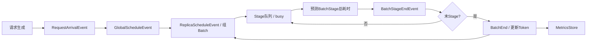
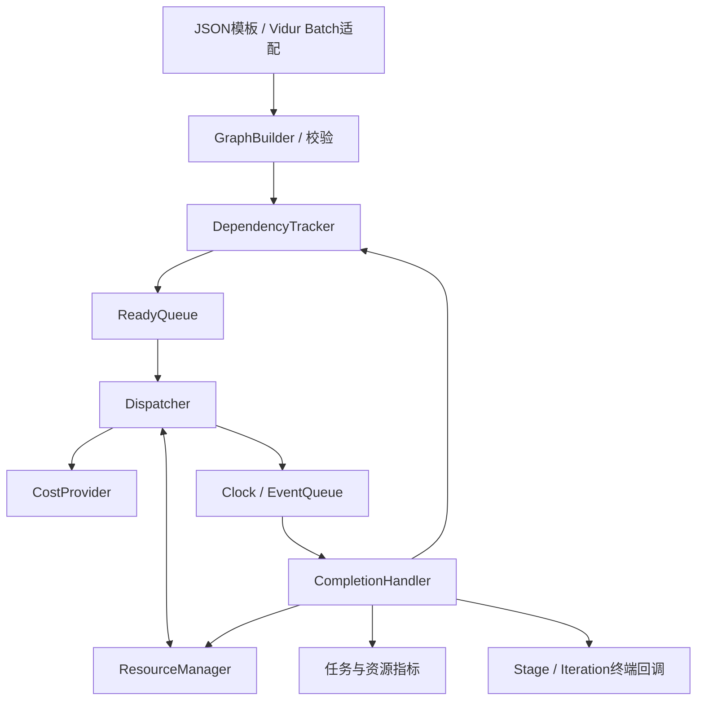
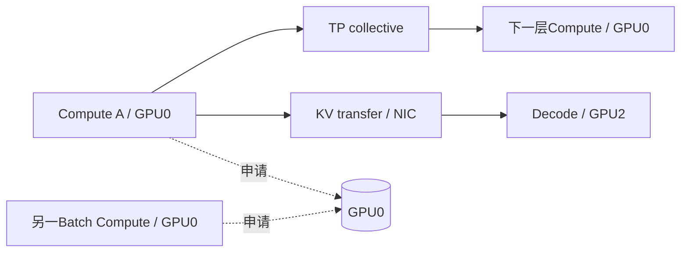
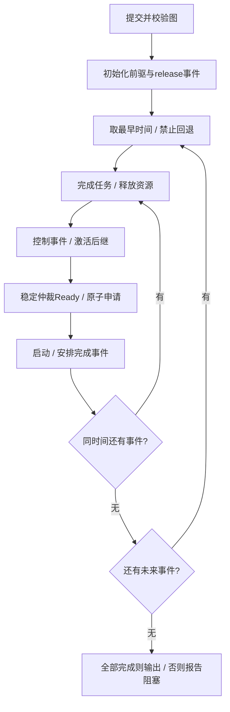
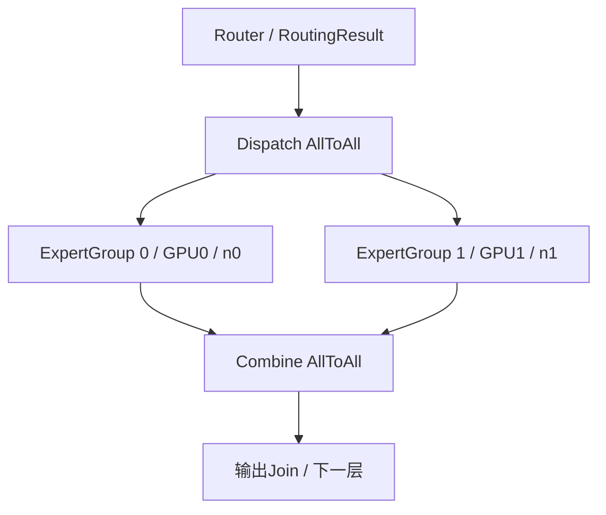

# LLM 推理 DAG 时间域仿真引擎：设计与实施计划

## 1. 目标与范围

**构建可执行的推理 DAG 时间域仿真引擎：按任务依赖和资源约束推进离散事件，输出任务开始、结束、等待时间及资源占用。**

建设主线：任务图 → 依赖就绪 → 资源分配 → 执行完成 → 激活后继。通信时延预测作为可替换的耗时提供器；PD 与动态 MoE 在同一引擎上扩展。

| 阶段 | 交付范围 | 完成标准 |
|---|---|---|
| 首月 | 固定 Batch、一轮阶段图；compute/collective/sync；容量1资源；常量与离线通信cost；时间线 | DAG可执行，手算正确，可复现；至少一条核验通过的SimAI通信cost进入节点执行 |
| 后续 | 接入Vidur Batch/Token；细化设备/网络/显存；PD KV；动态Expert与校准 | 请求与任务状态一致，依赖和争用可解释，误差与运行成本可测 |

首月不做动态组批、PD、逐kernel、在线ns-3、动态带宽公平分配或真实GPU画像。

## 2. 当前实现与缺口

### 2.1 当前执行链



### 2.2 能力与待解决问题

| 模块 | 已有能力 | 主要缺口 | 代码定位 |
|---|---|---|---|
| 事件引擎 | heapq按事件时间推进 | 缺少完整的过去事件拒绝、同时间戳处理规则 | [Simulator.run/_add_event](../../vidur-alibabacloud/vidur/simulator.py#L67)、[BaseEvent](../../vidur-alibabacloud/vidur/events/base_event.py#L44) |
| 请求DAG | Task/Flow、NetworkX图；实际建立Prefill→Decode | 图未控制就绪、资源分配及完成解锁；KV插图调用未执行 | [Request](../../vidur-alibabacloud/vidur/entities/request.py#L378)、[Splitwise.schedule](../../vidur-alibabacloud/vidur/scheduler/global_scheduler/splitwise_global_scheduler.py#L342) |
| Batch/Stage | 请求组批、逐Token迭代、Stage排队互斥、PP转发 | Stage内部计算通信仍为汇总耗时，无统一物理GPU/NIC仲裁 | [ReplicaStageScheduler](../../vidur-alibabacloud/vidur/scheduler/replica_stage_scheduler/replica_stage_schduler.py#L39)、[StageEnd](../../vidur-alibabacloud/vidur/events/batch_stage_end_event.py#L42) |
| 通信 | TP可调用SimAI；集合内部flow按入度执行 | 返回隔离时延；不同请求/Batch不共享在线网络状态 | [TPTimePredictor](../../vidur-alibabacloud/vidur/execution_time_predictor/communication_time_predictor.py#L58)、[NcclFlowModel](../../astra-sim-alibabacloud/astra-sim/system/collective/NcclFlowModel.cc#L127) |
| PD | P/D配置、KV大小估计、静态size/bandwidth延迟 | 源KV提前释放；D提前入队且未比较当前时间与KV就绪时间，存在提前执行风险，待端到端复现 | [BatchEnd](../../vidur-alibabacloud/vidur/events/batch_end_event.py#L90)、[SplitwiseReplicaScheduler](../../vidur-alibabacloud/vidur/scheduler/replica_scheduler/splitwise_replica_scheduler.py#L226) |
| 显存 | block分配、MemoryPlanner与KV占用跟踪 | 多账本及MLA/TP/PP的存储、传输口径需统一 | [MemoryPlanner](../../vidur-alibabacloud/vidur/scheduler/utils/memory_planner.py#L91)、[KV估计](../../vidur-alibabacloud/vidur/entities/request.py#L411) |
| MoE | 层级汇总耗时、随机负载/最忙rank近似 | 缺动态逐Expert任务、共享资源排队与dispatch/combine独立执行 | [MoE估时](../../vidur-alibabacloud/vidur/entities/execution_time.py#L568)、[负载近似](../../aicb/utils/utils.py#L898) |

### 2.3 实施前置条件

| 项目 | 状态与处理 |
|---|---|
| AICB单位与PP | 特定模型分支的秒值再次乘1e-3；PP>1时层范围未赋值，已局部验证。接入前修正或明确拒绝该组合。[代码](../../vidur-alibabacloud/vidur/entities/execution_time.py#L1286) |
| AICB通信计费 | TP分支为0，Attention/MLP读取通信量但未单独计时；需先确认画像是否融合通信。MoE带宽分支固定prefill。[代码](../../vidur-alibabacloud/vidur/execution_time_predictor/base_execution_time_predictor.py#L87) |
| P/D映射 | Cluster与Splitwise分别计算分区，可能不一致；统一由Placement提供。[代码](../../vidur-alibabacloud/vidur/scheduler/global_scheduler/splitwise_global_scheduler.py#L51) |
| 旧运行类 | Node/Link依赖未接通的clock、metrics和schedule_event，不能直接启用。[代码](../../vidur-alibabacloud/vidur/entities/node.py#L42) |
| 通信数据 | 已有AllReduce、AllToAll及TP2/EP4原始成功日志/CSV/flow；历史运行身份与单位仍有缺项。先作解析测试，核验后才进入cost表 |
| 合成负载 | 已有均匀/热点/长尾×EP32/128六组数据；tokens=16384、top-k=8、256 Experts，总assignments=131072。可作守恒测试，尚无源目的矩阵和真实Expert耗时 |
| 验证边界 | PD配置测试通过不能证明KV时序正确；trace重叠数值需修正精度后复核；尚无DAG执行核或真实性能校准通过结论 |

首月使用常量cost独立验证执行核，上述推理模型问题不阻塞开发；在接入对应路径前解决。

## 3. 架构与接口

### 3.1 模块边界

以下为拟议模块；保留现有请求生成、组批策略、预测数据与指标入口。



| 模块 | 单一职责 |
|---|---|
| GraphBuilder | 将固定模板或Batch快照转换为任务图，检查ID、引用与无环性 |
| DependencyTracker | 维护未完成前驱数，激活依赖满足的任务 |
| ReadyQueue / Dispatcher | 稳定选择就绪任务，尝试原子申请全部资源并启动 |
| ResourceManager | 容量、许可、等待者与释放；后续承接KV持久占用 |
| CostProvider | 返回匹配配置的服务时间或工作量，不修改仿真时间 |
| Clock / EventQueue | 推进唯一仿真时钟，排序事件、处理微步及终止 |
| CompletionHandler | 提交完成、释放资源、解锁后继、执行一次终端回调 |
| Metrics | 记录任务时序、等待原因、资源区间及请求关联 |

首月用独立CLI驱动执行核，后续由Vidur Simulator驱动同一实现，避免两套时钟和执行器。

### 3.2 节点、依赖与粒度

| 类型 | 表达内容 | 首月范围 |
|---|---|---|
| Compute | Attention、router、ExpertGroup等计算段 | 聚合常量或已有分项cost |
| Collective / Communication | TP AllReduce、EP dispatch/combine；后续PP与KV传输 | 一个覆盖通信组的原子节点 |
| Sync | 分支汇合、必要屏障 | 零时长，不占GPU |
| Memory（后续） | 有耗时的copy/pack/layout转换 | 容量reserve/free默认是资源动作 |

依赖边只表达数据完成、执行顺序、跨层/跨设备与同步关系；资源冲突由ResourceManager决定。



默认以Batch iteration或Prefill chunk生成图片段，按层选择性展开计算/通信；设备是placement维度。首月固定Batch一轮，MoE按rank专家组聚合。后续Decode按轮懒生成，必要时展开活跃Expert，完成片段可回收。共享Batch计算只执行一次，不按请求复制。

### 3.3 最小数据字段

| 对象 | 必需字段 |
|---|---|
| Graph | schema_version、graph_id、tasks、resources |
| Task | id、kind、predecessors、rank_ids、resource_demands、cost_ref或duration_ns（二选一） |
| Collective属性 | op、group_id、members、dispatch/combine阶段、payload_bytes及其per-rank/per-peer/全组口径 |
| Resource | id、type、capacity；首月capacity=1 |
| Cost | duration_ns、适用配置、是否包含计算/通信/overhead、核验状态 |
| Runtime | state、remaining_predecessors、ready/start/end、lease_ids、完成事件版本 |

phase、layer、batch/iteration、request slices作为可选元数据；接入推理时补齐。单位统一为整数ns，原始时间只在适配边界转换。零时长合法；负数、NaN/Inf、缺失cost和超容量需求报错。

建议接口：

```text
build(batch_or_template, placement) -> Graph
submit(graph, release_time) -> GraphHandle
estimate(task, context) -> Cost
try_acquire(task, now) -> Leases | WaitReasons
complete(task_id, now) -> ReadyTasks
release(leases, now) -> AffectedWaiters
on_terminal(graph_id, now) -> ControlEvents
```

### 3.4 时间与事件规则

生命周期：`Created → Pending → Ready → Running → Completed`。资源不足时保持Ready并记录等待；失败/取消为独立终态，首月不支持运行中抢占。

```text
earliest_start(v) = max(release_time(v), completion_time(各前驱))
actual_start(v) >= earliest_start(v)
completion_time(v) = actual_start(v) + duration(v)
ready_wait(v) = actual_start(v) - earliest_start(v)
```

固定服务时间模式采用上式；后续共享带宽模式按剩余bytes和速率积分更新完成事件。

事件键为 `(time_ns, microstep, phase, sequence_id)`；同时间先完成/释放，再控制事件与后继激活，最后稳定仲裁Ready任务。零时长完成进入下一微步，直到当前时间无新事件。所有资源all-or-nothing申请；重复/失效完成事件不能重复释放或解锁。



### 3.5 资源与cost规则

| 资源/模式 | 实现规则 |
|---|---|
| GPU Compute | 首月每rank一个许可；后续映射物理GPU，group任务原子申请所有成员 |
| Communication | 首月各成员comm资源互斥；可配置collective同时占compute，比较两种假设 |
| NIC/Link（后续） | 显式路径和端点争用；先独占服务，再按研究需要增加fluid共享带宽 |
| Memory/KV（后续） | 容量与持久lease，模型权重、KV、workspace分开；统一动态账本 |

无依赖且资源不冲突才允许重叠。collective占用GPU的方式必须显式配置；不能仅凭图分叉认定真实GPU可完全并行。离线通信cost加资源互斥只模拟粗粒度排队，不模拟在线网络拥塞。

cost接入要求：

- 精确匹配操作、组规模、消息口径、placement、拓扑/带宽与后端配置；缺项报错。
- 优先取单操作通信服务时间，核对是否混入计算、多操作和额外开销；同一费用只计一次。
- 历史身份/单位未齐的CSV只作解析或明确标注的演示，不进入核验通过的cost表。
- 失败日志、0 collective/streams、跨用例错配CSV不作有效cost；不将NaN或导入失败填0。
- AllReduce现有作业含两个streams和计算，需拆清单操作或补跑隔离用例。EP历史配置为TP2/EP4，不能直接用于TP1/EP4模板。

### 3.6 PD与MoE扩展

**PD：** P/D使用独立计算资源；发送前源KV保持pin，目标预留接收容量；接收提交后产生KVReady，之后才能进入Decode可组批队列。源/目标KV的存储与wire bytes按layout计算，P/D不同TP/PP时显式重分片。


**MoE：** 每轮每层生成一次RoutingResult，包含Expert计数、placement和dispatch/combine矩阵；同轮up/down复用路由。按活跃Expert或真实grouped GEMM组计算独立cost，同卡共享compute，输出join等待必要分支。



首月MoE固定EP4、TP1、PP1：router/ExpertGroup/output按rank建节点，dispatch和combine各覆盖全部参与rank，分别声明cost。已有合成负载可作守恒测试；转为EP4需重新聚合placement，不能从目的端负载推导唯一网络矩阵。动态Expert、chunk流水及尾延迟验证在后续实施。

### 3.7 现有模块改造边界

| 模块 | 处理方式 | 关键约束 |
|---|---|---|
| RequestGenerator、全局/副本组批策略 | 复用，输出Batch快照 | 策略决定成员，DAG决定执行；Decode下一轮依赖上一轮完成 |
| Request/Batch与MetricsStore | 适配终端回调、任务关联 | Stage/iteration只更新一次token与指标，子任务不得重复累计 |
| ReplicaStageScheduler与Stage事件 | 先映射一个coarse任务，再展开 | 图terminal完成才触发原StageEnd；PP节点不重复计时 |
| ExecutionTimePredictor/AICB/通信预测器 | 转为cost adapter | 统一单位、适用配置与费用清单；缺分项时不强拆总时长 |
| Cluster/Replica/MemoryPlanner | 提供Placement与初始预算 | P/D分区唯一来源；动态资源账本统一 |
| Node/Task/Flow/Link | 可复用描述，不直接调用旧生命周期 | 执行状态归新runtime |
| Astra-Sim/SimCCL/ns-3 | 先离线cost，在线协同后续评估 | 宿主运行耗时不计入仿真；同一网络服务不重复收费 |

